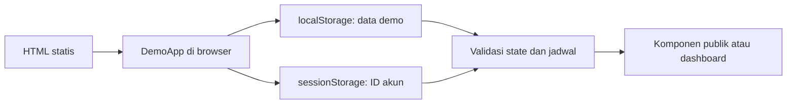
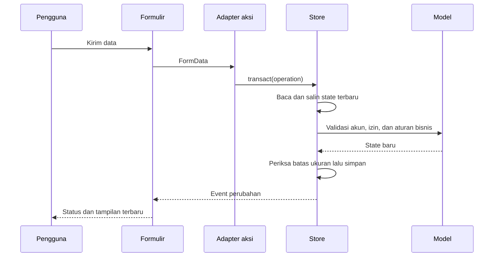

# Arsitektur Aplikasi

## 1. Lingkup

Repository ini merupakan adaptasi demo dari website FESTIKA UNAND. Antarmuka publik, peserta, panitia, dan admin menggunakan komponen yang sama, sedangkan penyimpanan dan operasi bisnis menggunakan adapter browser. Tidak terdapat koneksi ke database produksi, endpoint email, atau penyimpanan Supabase.

## 2. Struktur direktori

```text
app/
  [[...path]]/page.tsx  Daftar rute yang diekspor secara statis
  layout.tsx           Metadata, tema, font lokal, dan animasi navigasi
  actions.ts           Login, pendaftaran, pengelolaan event dan tim
  platform-actions.ts  Pembayaran, konten, Inbox, akun, dan media
  staff-actions.ts     Pembuatan akun dan izin panitia
components/
  demo-app.tsx         Komposisi halaman dan pembacaan state browser
  portal.tsx           Dashboard dan kartu event
  registration-workspace.tsx
  cms-workspace.tsx
  public-site.tsx
  ...                  Komponen presentasi dan formulir
lib/
  demo/model.ts        Tipe state dan aturan bisnis yang dapat diuji tanpa browser
  demo/seed.ts         Data contoh dan jadwal awal
  demo/store.ts        Transaksi localStorage, sesi, file, dan notifikasi perubahan
  demo/navigation.ts   Penghubung aksi non-komponen ke router
  demo/paths.ts        Penyesuaian alamat aset untuk hosting subpath
  event-schedule.ts    Penurunan tanggal event dari Timeline
  event-schema.ts      Validasi formulir event
  content-model.ts     Jenis dan validasi konten
  permissions.ts       Peran, izin modul, dan tujuan dashboard
public/branding/       Identitas visual, ilustrasi, dan PDF contoh
tests/                 Pengujian aturan bisnis serta alur browser
scripts/               Server statis dan pembuat aset contoh
docs/                  Dokumentasi teknis
```

## 3. Aliran pembacaan



Server menghasilkan kerangka halaman. Setelah hidrasi, `DemoApp` berlangganan melalui `useSyncExternalStore`. Snapshot berupa string penyimpanan agar identitas snapshot stabil di antara perubahan.

`initializeStore()` membuat seed hanya jika key penyimpanan belum ada. Data lama tidak ditimpa setiap navigasi. State yang tidak dapat dibaca menampilkan kontrol pemulihan melalui Reset demo.

## 4. Aliran perubahan



`transact()` menggunakan salinan state. Jika operasi melempar error, state baru tidak ditulis. Jika Web Locks tersedia, seluruh penulisan memakai lock `festika-demo:write` untuk mengurangi konflik antartab. Browser yang tidak mendukung Web Locks memakai operasi sinkron tanpa jaminan transaksi antartab.

Upload dibaca sebelum transaksi dimulai. Operasi bisnis di dalam callback transaksi tetap sinkron sehingga tidak meninggalkan lock saat pembacaan file berlangsung.

## 5. Routing

`app/[[...path]]/page.tsx` menyediakan `generateStaticParams()` untuk rute publik serta modul dashboard. `dynamicParams` dinonaktifkan karena hasil harus dapat disajikan sebagai file statis.

Event baru tidak membutuhkan pembuatan file HTML baru. Detailnya diakses melalui `/kompetisi/detail?slug=...`, kemudian dipilih dari state browser. Tiga slug awal juga memiliki rute statis untuk kenyamanan akses.

`DemoApp` memeriksa akun dan izin sebelum memilih komponen dashboard. Pembatasan ini mengatur pengalaman demo, bukan akses data pada server. Semua state berada pada browser pengunjung.

Pratinjau Draft memakai halaman `/admin/preview?entry=...` atau `/panitia/preview?entry=...`, sehingga tidak membutuhkan path HTML baru untuk setiap entry. `prepare-static-export.mjs` berjalan sebagai `postbuild` dan menambahkan alias datar untuk file segment-prefetch Next 16; host statis dapat melayani URL navigasi tanpa aturan rewrite server khusus.

## 6. Pemisahan data Draft dan publik

Event memiliki koleksi `drafts` dan `events`. Konten memiliki koleksi `entries` dan `publications`. Formulir **Simpan Draft** hanya mengubah Draft. **Publikasikan** menyalin data yang telah divalidasi ke koleksi publik.

Timeline yang sudah dipublikasikan menurunkan tanggal kegiatan dan periode pendaftaran melalui `withEventSchedule()`. Sinkronisasi dilakukan pada event publik dan Draft agar tanggal tidak kembali ke nilai lama saat event dipublikasikan ulang.

## 7. File lokal

File disimpan sebagai data URL di JSON, lalu dikonversi menjadi object URL saat ditampilkan. `localFileUrl()` menggunakan cache agar URL yang sama tidak dibuat berulang pada setiap render. Reset mencabut object URL yang masih dipegang halaman.

Media menggunakan referensi `/media/<id>` pada Draft. Referensi tersebut bukan endpoint HTTP; `DemoApp` menyelesaikannya ke file lokal sebelum menyerahkan data ke komponen publik.

## 8. Pertimbangan implementasi

- Static export dipilih agar repository dapat dicoba pada hosting statis.
- Adapter berbentuk fungsi mempertahankan kontrak formulir tanpa membutuhkan server action.
- State tunggal memudahkan penelusuran perubahan, tetapi membatasi jumlah data dan ukuran file.
- Sesi per tab memudahkan pengujian peserta dan admin secara bersamaan.
- Reset mengembalikan seed yang diketahui, sehingga pengujian dapat diulang tanpa membersihkan database server.

## 9. Perbedaan terhadap sistem produksi

Versi produksi memerlukan autentikasi server, database, transaksi database, object storage, kontrol akses pada setiap operasi, dan pengiriman email. Repository demo tidak menyertakan implementasi maupun konfigurasi layanan produksi tersebut. Rencana adaptasi dijelaskan pada [DEVELOPMENT.md](DEVELOPMENT.md).
