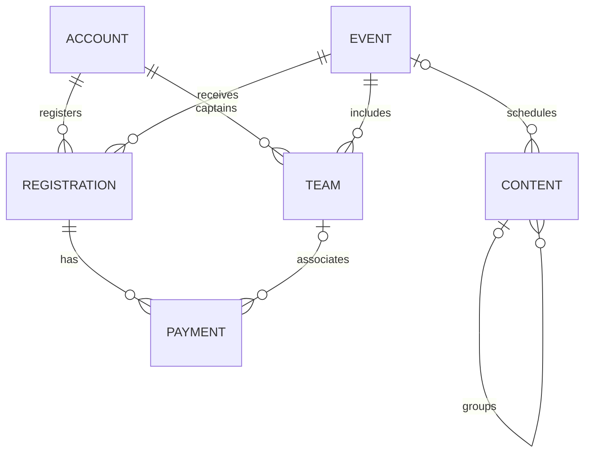

# Model Data dan Penyimpanan

## 1. Lokasi penyimpanan

| Key | Media | Isi |
| --- | --- | --- |
| `festika-demo:data:v1` | localStorage | Seluruh `DemoState`, diserialisasi sebagai JSON |
| `festika-demo:session:v1` | sessionStorage | ID akun aktif pada tab saat ini |
| `festika-theme` | Cookie | Pilihan tema tampilan |

Origin mencakup protokol, hostname, dan port. `localhost:3000`, `127.0.0.1:3000`, dan `127.0.0.1:3001` memiliki penyimpanan berbeda. Path repository GitHub Pages berada dalam origin pengguna yang sama; key demo ini memakai namespace FESTIKA, bukan sistem isolasi berdasarkan path.

## 2. Entitas

Definisi lengkap tersedia pada `lib/demo/model.ts`, `lib/types.ts`, dan `lib/content-model.ts`.

| Koleksi | Identitas dan relasi | Kegunaan |
| --- | --- | --- |
| `accounts` | `id`, `role`, `permissions` | Profil, password contoh, status aktif, dan izin modul |
| `events` | `id`, `slug` | Event yang telah dipublikasikan beserta tanggal, biaya, dan kuota |
| `drafts` | `id` event | Salinan event yang sedang diedit |
| `entries` | `id`, `event_id`, `parent_id` | Draft konten dan relasi ke event atau album |
| `publications` | `id` entry | Versi konten yang terlihat pada halaman publik |
| `registrations` | `id`, `user_id`, `event_id` | Pendaftaran, status, snapshot biaya, dan batas waktu slot |
| `teams` | `id`, `ketua_id`, `event_id` | Nama tim, daftar nama anggota, dan status pembayaran |
| `payments` | `id`, `registration_id`, `team_id` | Bukti contoh dan hasil verifikasi |
| `messages` | `id` | Pesan formulir Message dan status penanganannya |
| `media` | `id`, `object_path` | Metadata unggahan gambar atau PDF |
| `files` | `/media/<id>` → data URL | Isi file media |
| `history` | `registration_id` | Riwayat penerimaan setelah verifikasi pembayaran |
| `audit` | `id`, `actor` | Maksimal 100 aktivitas pengelolaan terakhir |
| `recoveries` | `token`, `userId`, `expires` | Tautan reset simulasi dengan masa berlaku 15 menit |

Password akun disimpan sebagai string untuk kebutuhan simulasi. Penyimpanan ini tidak boleh digunakan sebagai rancangan penyimpanan password aplikasi produksi.

## 3. Relasi utama

`member_names` memuat nama ketua pada indeks pertama. Nama anggota lain tidak memerlukan akun terpisah. Identitas nama dalam demo tidak diverifikasi dan tidak menjadi bukti keikutsertaan orang sebenarnya.

## 4. Status pendaftaran

| Kondisi | Hasil |
| --- | --- |
| Kompetisi gratis | `diterima`, tanpa tenggat pembayaran |
| Kompetisi berbayar baru | `pending`, tenggat 24 jam |
| Pembayaran terverifikasi | `diterima`, tenggat dihapus |
| Pembayaran ditolak | Tetap `pending` sampai diganti atau tenggat habis |
| Peserta membatalkan | `dibatalkan` dan tim terkait diarsipkan |
| Tenggat habis | `dibatalkan`; slot dapat digunakan kembali |

Evaluasi kedaluwarsa dilakukan saat state dibaca untuk tampilan dan saat operasi baru diproses. Tidak ada cron, worker, atau pembaruan berkala saat halaman dibiarkan diam.

## 5. Kuota

Pendaftaran berstatus diterima selalu dihitung. Pendaftaran pending dihitung selama tenggatnya masih berlaku. Pendaftaran dibatalkan tidak dihitung.

Untuk kompetisi individu, sisa slot dihitung dari kuota peserta. Untuk kompetisi tim, batas slot berasal dari nilai terkecil antara `maks_tim` dan `floor(kuota / anggota_tim)`. Satu pendaftaran ketua mewakili satu tim.

## 6. Status pembayaran

`pending` berarti menunggu pemeriksaan. `verified` menerima pendaftaran secara otomatis. `rejected` membutuhkan alasan. Ketika peserta mengirim bukti pengganti, bukti sebelumnya ditandai `replaced`.

Pembayaran yang sudah terverifikasi tidak dapat diturunkan statusnya melalui formulir demo. Bukti untuk slot yang sudah berakhir tidak dapat diverifikasi. Pembatalan tidak menjalankan refund karena tidak ada transaksi uang.

## 7. Jadwal

Field `schedule_role` pada payload Timeline menentukan kegunaan tanggal:

| Nilai | Pengaruh |
| --- | --- |
| `registration` | Mengisi `registration_start` dan `registration_end` |
| `event` | Mengisi `tanggal` kegiatan utama/final |
| `other` | Ditampilkan sebagai tahap tanpa mengubah periode pendaftaran |
| Kosong | Pengenalan kompatibilitas dari nama atau slug Pendaftaran dan Final |

Setiap event memiliki paling banyak satu jadwal `registration` dan satu jadwal `event`. Duplikasi jadwal utama ditolak. Periode berlaku dari 00.00 tanggal awal sampai 23.59.59 tanggal akhir dalam WIB. End yang kosong memakai tanggal awal.

Tanggal seed bersifat relatif terhadap waktu browser ketika demo pertama dibuat. Reset menghasilkan periode baru. Perubahan waktu komputer juga memengaruhi pemeriksaan tenggat dan masa berlaku token.

## 8. File dan ukuran

Upload dibatasi 350.000 byte per file. Data URL memiliki overhead sekitar sepertiga dari ukuran file asli. `transact()` membatasi serialisasi state pada 4.000.000 byte; ini batas aplikasi, bukan jaminan kapasitas browser.

Validasi memeriksa MIME dan awalan signature JPEG, PNG, PDF, atau WebP. Pemeriksaan ini bukan pemindaian malware atau validasi penuh isi dokumen. PDF hanya digunakan untuk panduan atau bukti contoh. SVG unggahan tidak diterima.

Media yang masih dirujuk oleh Draft, publikasi, atau poster/panduan event tidak dapat dihapus. Hapus referensinya terlebih dahulu.

## 9. Perubahan versi state

`version: 1` dan suffix `:v1` menandai kontrak penyimpanan. Jika struktur diubah secara tidak kompatibel, tambahkan migrasi data yang diuji atau gunakan namespace versi baru. Jangan mengubah arti field lama tanpa menyediakan cara reset atau migrasi.

Reset mengganti seluruh state dengan seed baru dan menghapus sesi tab aktif. Tab lain akan menerima event storage; sesi tab lain dapat tetap menunjuk akun bawaan yang masih tersedia. Reset tidak menghapus cookie tema.
